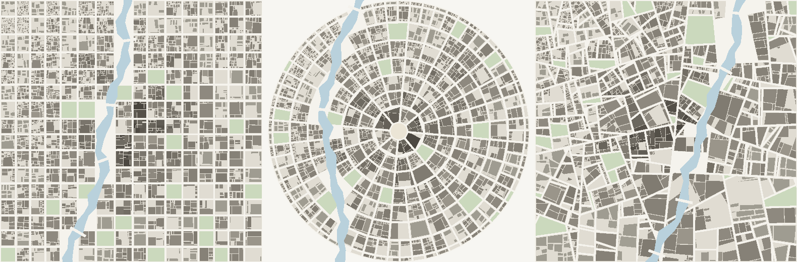

# Procedural City

A minimalist 2D top-down city map generator. You set the dials — seed, street plan,
extent, block size, density, green space, irregularity, river — and it draws a whole
city: street grid, blocks, lots, buildings, parks, waterfront and bridges.

Everything is generated in the browser from a seed. No assets, no map data, no runtime
dependencies — the generator is a few hundred lines of plain TypeScript and the map is
drawn straight to a `<canvas>`.



## Quick start

```bash
npm install
npm run dev      # http://localhost:5173
```

```bash
npm run build    # typecheck + production bundle into dist/
npm run preview  # serve the built bundle
npm run typecheck
```

## Using it

| Input | What it changes |
| --- | --- |
| **Seed** | Any text. The same seed and settings always rebuild the identical city. |
| **Street plan** | `Grid` (jittered Manhattan), `Radial` (rings and spokes around a plaza), `Organic` (recursive irregular partition, old-town feel). |
| **Extent** | Map edge length, 0.8–6 km. |
| **Block size** | Target city-block edge, 60–400 m. |
| **Street width** | Street corridor width, 6–44 m. Blocks are the land left after streets are carved out. |
| **Density** | Drives lot size, building setbacks and storey counts. |
| **Green space** | Share of blocks turned into parks. |
| **Irregularity** | 0 is ruler-straight, 1 is wonky — jitters street spacing and every subdivision cut. |
| **River / width** | Carves a river across the map, clears the blocks it runs through and throws 2–4 bridges across it. |

Drag to pan, scroll to zoom, double-click to fit. `R` new seed, `F` fit, `T` toggle
light/night theme, `E` export PNG. **PNG** exports a 2048px map; **JSON** exports the
city as data (zones, block polygons, building footprints and storeys).

Building fill darkness tracks storeys on an absolute scale, so the downtown core reads
darker and denser than the suburbs on the same map.

## How a city gets built

The generator is a pure pipeline in `src/core/` — same params in, same city out, no
rendering concerns:

1. **Layout** (`layout.ts`) covers the land with convex cells. Grid lays down two sets
   of jittered parallel streets; radial builds rings whose spoke count doubles outward
   so blocks stay a similar width; organic recursively splits the whole plot.
2. **Water** (`water.ts`) traces a river by midpoint displacement between two map edges,
   thickens it into a band, and picks bridge crossings.
3. **Zoning** (`zoning.ts`) weights downtown / commercial / residential / industrial /
   park by distance from the centre, then rolls one per cell.
4. **Blocks** (`generate.ts`) drops cells the river runs through and insets the rest by
   half the street width — the gap *is* the street.
5. **Lots** (`lots.ts`) subdivides each block until the pieces hit a zone-specific target
   area, then insets each lot by its setback to get a building footprint and assigns
   storeys from a zone-skewed distribution.

Blocks stay convex the whole way through, which keeps the three geometry operations in
`geom.ts` — clip, split, inset — exact and fast. A 6 km city with ~10,000 buildings
generates in well under 100 ms.

`src/render/` then draws it: the renderer caches one set of `Path2D` layers per city and
batches buildings into shade buckets, so panning and zooming never rebuild geometry.

## Project layout

```
src/
  core/        generator — pure, deterministic, no DOM
    geom.ts        convex polygon maths (clip, split, inset, centroid)
    rng.ts         seeded PRNG (mulberry32)
    subdivide.ts   recursive polygon halving, shared by districts and lots
    layout.ts      grid / radial / organic street plans
    water.ts       river + bridges
    zoning.ts      zone weights by distance from centre
    lots.ts        lots, setbacks, storeys
    generate.ts    the pipeline
    types.ts       CityParams, City, Block, Building, defaults
  render/      canvas drawing — reads a City, never mutates it
    camera.ts      pan / zoom / fit
    palette.ts     paper + night themes
    renderer.ts    Path2D layer cache, PNG export
  ui/          control panel and stylesheet
  main.ts      wiring: params -> generate -> draw
```

## Roadmap

- Named districts and street labels
- Coastline and lake water bodies, not just a river
- Highways and rail corridors that cut across the plan
- Terrain: elevation that bends streets and keeps towers off slopes
- Paint-in zones instead of distance-based zoning
- SVG export
